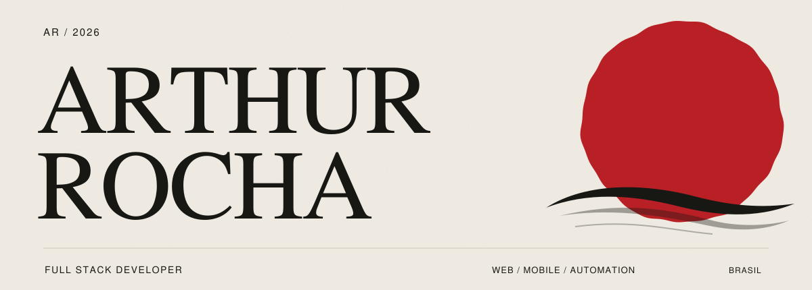

  

  <a href="https://arthurcrocha.netlify.app/">PORTFOLIO ↗</a>
  &nbsp;&nbsp;·&nbsp;&nbsp;
  <a href="https://www.linkedin.com/in/arthur-candian-3b346124a/">LINKEDIN ↗</a>
  &nbsp;&nbsp;·&nbsp;&nbsp;
  <a href="mailto:arthurcandian@gmail.com">EMAIL ↗</a>

00 / PROFILE
Desenvolvedor Full Stack com background em design.
Construo produtos entre código, dados, mobile e interface — com atenção especial à forma como sistemas funcionam e à forma como são percebidos.
Full Stack Developer with a design background — building across code, data, mobile and interface.
DESIGN DIDN'T REPLACE CODE. IT CHANGED HOW I BUILD IT.

01 / NOW
<table>
  <tr>
    <td>WORK / 01 <strong>Bioma Investimentos</strong></td>
    <td>Estagiário de Desenvolvimento · Flutter, integrações, SQL e suporte AGO 2026 → PRESENTE</td>
  </tr>
  <tr>
    <td>STUDY / 02 <strong>Univiçosa</strong></td>
    <td>Análise e Desenvolvimento de Sistemas 2026 → PRESENTE</td>
  </tr>
  <tr>
    <td>FOCUS / 03 <strong>Building</strong></td>
    <td>Full-stack systems · Mobile · Automation · Design-aware engineering</td>
  </tr>
</table>

02 / SELECTED WORK
01 — PRODISel
Do dado legado ao celular do motorista.
Aplicação mobile para transportadores de leite, com trabalho atravessando o fluxo completo do produto:
<pre>
LEGACY ERP        SYNC / SENDER        API                 MOBILE
SQL Server   →    Python / PowerShell  → FastAPI/Postgres  → Flutter
T-SQL
</pre>

Atuação em descoberta de produto, integrações, domínio de motorista, autenticação, sincronização, testes e validação em aparelho real.
Flutter · Dart · FastAPI · PostgreSQL · SQL Server / T-SQL · Python
02 — CV STANDARDIZATION
Informação desestruturada → estrutura consistente.
Automação em Python + Gemini API para padronização de currículos em fluxos de RH, preservando as informações originais enquanto normaliza estrutura e saída.
Python · Gemini API · LLM · Automation
03 / CRAFT
<table>
  <tr>
    <td>INTERFACES</td>
    <td>Flutter · React · Angular · TypeScript · JavaScript</td>
  </tr>
  <tr>
    <td>BACKEND</td>
    <td>Python · FastAPI · Node.js · Express · Java</td>
  </tr>
  <tr>
    <td>DATA</td>
    <td>PostgreSQL · SQL Server / T-SQL · MySQL · Redis</td>
  </tr>
  <tr>
    <td>TOOLS</td>
    <td>Docker · Git/GitHub · Codemagic · REST · JWT</td>
  </tr>
  <tr>
    <td>VISUAL</td>
    <td>UI/UX · Figma · Photoshop · Canva · audiovisual</td>
  </tr>
</table>

Sem porcentagens ou níveis artificiais: as ferramentas aparecem ligadas ao trabalho onde fazem sentido.
04 / BUILD LOG
2026 / PORTFOLIO
Redesign completo do portfólio com direção editorial japonesa, Three.js / React Three Fiber e GSAP.
2026 / PRODISel
Integração ponta a ponta entre legado, sincronização, API e aplicativo mobile.
2026 / CV STANDARDIZATION
Automação de documentos com Python e IA generativa aplicada a um fluxo real de RH.
05 / PATH
<pre>
2017–18    creative background
    ↓
2020       computing
    ↓
design     visual practice
    ↓
frontend   interfaces / Angular
    ↓
full-stack mobile / integrations / data
    ↓
2026       ADS / Univiçosa
    ↓
NOW        still learning · still building
</pre>

A trajetória não foi uma linha reta — e isso virou parte de como eu construo.
06 / CONNECT
Vamos construir algo.
Portfolio ·
LinkedIn ·
Email ·
GitHub

ARTHUR ROCHA · FULL STACK DEVELOPER · BRAZIL / 2026
つづく
TO BE CONTINUED.
